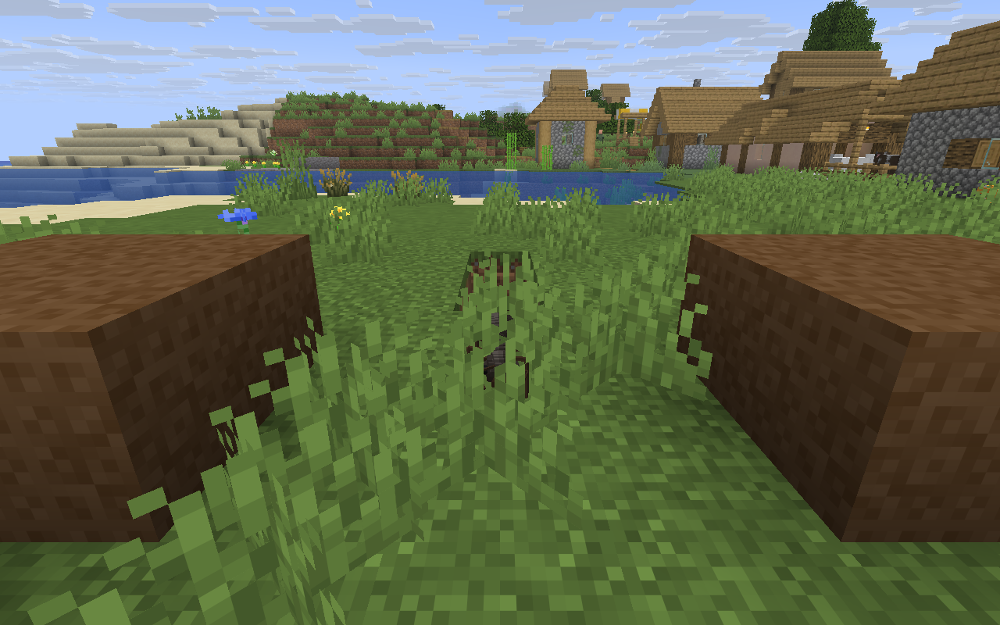
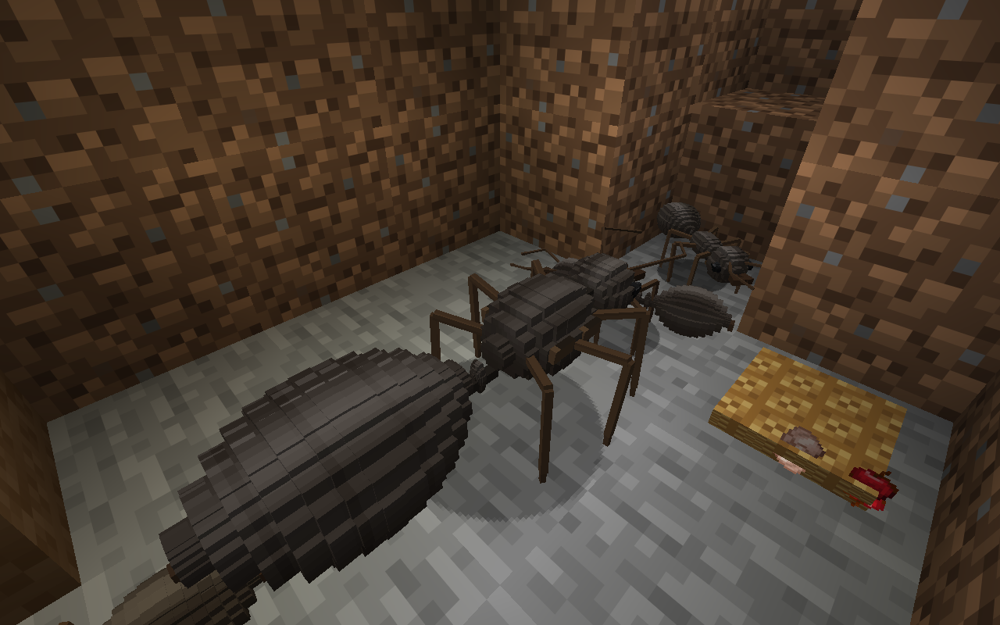

<p align="center">
  
</p>

<h3 align="center">Wild, realistic ant colonies for Minecraft. Every ant is a real creature.</h3>

<p align="center">
  🇷🇺 <a href="README.ru.md">Читать на русском</a>
</p>

<p align="center">
  
  
  
  
  <br>
  <a href="https://github.com/SupremeSoviet/prime-ants/releases/latest"></a>
  
  
  <a href="LICENSE"></a>
</p>

<p align="center">
  <a href="https://github.com/SupremeSoviet/prime-ants/releases/latest"><b>⬇️ Download</b></a> ·
  <a href="#-getting-started">Getting started</a> ·
  <a href="#%EF%B8%8F-gallery">Gallery</a> ·
  <a href="#%EF%B8%8F-roadmap">Roadmap</a> ·
  <a href="CHANGELOG.md">Changelog</a>
</p>

---

## 🐜 What is this?

Prime Ants fills your world with wild colonies of the black garden ant, *Lasius niger*.

A young queen chooses a patch of meadow, digs a small chamber and raises her first workers on her own. Then the
colony takes over: workers open the entrance, carry soil out into a mound, bring home nectar and prey, and feed the
brood mouth to mouth. With enough food, and some clay and stone from you, a colony keeps growing: it digs new
chambers, rebuilds them in clay and stone, mines, and finally fortifies its mound.

There are no hidden counters. **A colony is exactly the ants you can see.** If one dies, it is gone, and the colony has
to raise a replacement.

## ✨ Features

| | |
|---|---|
| 👑 **Queens found colonies on their own** | in plains, meadows and flower forests, dug into natural terrain |
| 🥚 **A real brood cycle** | egg → larva → cocoon → pale young worker → adult |
| ⛏️ **Nests dug into the ground** | stairs and chambers two blocks high, with the soil carried out into a mound |
| 🌼 **Real food, carried home** | nectar from flowers, small prey in the grass, and tasty things you drop |
| 🤝 **Sharing** | nurses feed the queen and the larvae, and workers pass sugar mouth to mouth |
| 📈 **Growth that follows food** | a colony grows only as fast as food comes in; ants age, starve and die |
| 🏛️ **Colony stages** | Founding → Young → Mature → Great, up to 120 adults, and back down if things go wrong |
| 🧱 **Chambers and upgrades** | nursery, food store, material store and queen's hall, rebuilt in packed clay and then stone |
| ⛏️ **Mining** | a miner digs a gallery and carries stone, clay, gravel and sand home, one piece at a time |
| 🏰 **Great fortifications** | a gate, ramparts and watch posts around the mound of a Great colony |
| 🌍 **Established nests** | Young and Mature colonies already live in newly generated terrain |
| 💾 **Catch-up** | when you come back to an area, its colonies catch up on the time you were away |
| 🛡️ **They defend their home** | hurt an ant or break the nest, and nearby workers will bite |
| 🔦 **You can visit** | walk down the stairs into the nest and watch the nursery |

> 🕰️ One in-game day is roughly one month in the life of a colony.

## 🖼️ Gallery

| | |
|:---:|:---:|
| <br><sub>A young colony's nest next to a village</sub> | <br><sub>A worker at the nest entrance</sub> |
| <br><sub>The queen, workers and the food store inside the nest</sub> | <br><sub>The food store seen from the other side of the chamber</sub> |

<sub>Screenshots from version 0.2.0 in a new Survival world. The banner shows an earlier ant model.</sub>

## 🚀 Getting started

**You need:** Minecraft Java Edition 26.3 · Java 25 · Fabric Loader 0.19.5 · Fabric API 0.161.0+26.3

1. Install a [Fabric](https://fabricmc.net/use/installer/) profile for Minecraft 26.3.
2. Download `prime_ants-0.2.0.jar` from the [latest release](https://github.com/SupremeSoviet/prime-ants/releases/latest)
   and put it, together with the matching [Fabric API](https://modrinth.com/mod/fabric-api), into your `mods` folder.
3. Create a **new world** and go looking for ants. 🔍

For multiplayer, install the mod and Fabric API on the server and on every client.

## 🔎 Finding and enjoying a colony

- **Where to look.** Plains, meadows and flower forests. Look for a small mound of soil next to a stair entrance, or a
  queen busy digging. Older colonies have bigger mounds, and Great colonies are walled.
- **Be patient.** Each brood stage takes about 10 minutes, and the first workers appear about half an hour after the
  first eggs.
- **Feeding.** Drop apples or sweet berries (sugar) and raw chicken or rotten flesh (protein) near a trail, then step
  back at least four blocks. Foragers pick the food up and carry it home.
- **Helping with materials.** Colonies need clay to grow: a Young colony needs 16 clay balls to become Mature, and it
  can't mine yet. Drop clay balls near a trail and foragers carry them to the material store. Stone chambers need
  smooth stone (cobblestone doesn't work). Gravel, sand and ore are welcome too.
- **Visiting.** Once the workers open the entrance, walk down the two-block-high stairs. Supported dry torches,
  soul torches and lanterns can light the colony's existing openings. Wall torches and standing or hanging lanterns
  work too. Use lanterns in workers' added rooms or generated nest rooms, and leave a route around them: ants collide
  with them.
- **Manners.** Watching and feeding are welcome. Hitting ants or breaking their nest makes the workers bite (half a
  heart per bite).

More in the [player guide](docs/player-guide.md).

## ⚠️ Good to know

- There is one species so far, *Lasius niger*.
- **Preserve the nest.** Solid blocks still revoke the colony's openings; removing them or placing a light does
  not restore ownership. Lighting damage already saved in 0.2.0 also cannot recover automatically.
- **Colonies rely on your clay and stone.** Without clay from players, wild colonies stay Young. Mature colonies need
  more clay for their upgrades, and stone chambers need smooth stone. Their own mining is a single short gallery.
- Colonies are fully alive only while their chunks are loaded. When you return, a simplified
  [catch-up](docs/catch-up.md) moves them forward by the time you were away.
- **Large colonies are heavy on the server.** One Great colony with 120 ants runs at 20 TPS on a fast desktop CPU,
  with little headroom. Three Great colonies close together drop the server to about 7 TPS. Performance work is under
  way; see [performance](docs/performance.md).
- Awkward terrain, food shortages and crowding can stall a colony.
- Long sessions and multiplayer have had limited testing. Back up your worlds.

## 🗺️ Roadmap

- ⚡ large colonies without lag (in progress)
- ⚒️ a forge chamber that smelts ore, and soldiers in resin, copper and iron armour
- 🤝 relations between colonies: gifts, tribute, alliances, border fights and wars
- 🎁 barter with the player, and a guest house from an allied colony
- 🪽 nuptial flights, with young queens founding new colonies nearby
- 🌿 aphid herding and honeydew
- 🐜 more species: the red wood ant, a harvester ant and a leaf-cutter ant

## 🛠️ Building from source

You need JDK 25.

```bash
./gradlew build
```

The jar ends up in `build/libs/`. `build` also runs the whole test suite, including the long in-game tests, which takes
a while. For a quick check while you work, run `./gradlew checkFast`. See [development](docs/development.md) and
[testing](docs/testing.md).

## 📚 More

- [Player guide](docs/player-guide.md)
- [Changelog](CHANGELOG.md)
- [How a colony develops](docs/colony-development.md)
- [Catch-up for unloaded colonies](docs/catch-up.md)
- [Performance](docs/performance.md)
- [Development](docs/development.md) and [testing](docs/testing.md)
- [Design documents](docs/README.md) (mostly in Russian)

## 📄 License

[MIT](LICENSE)
