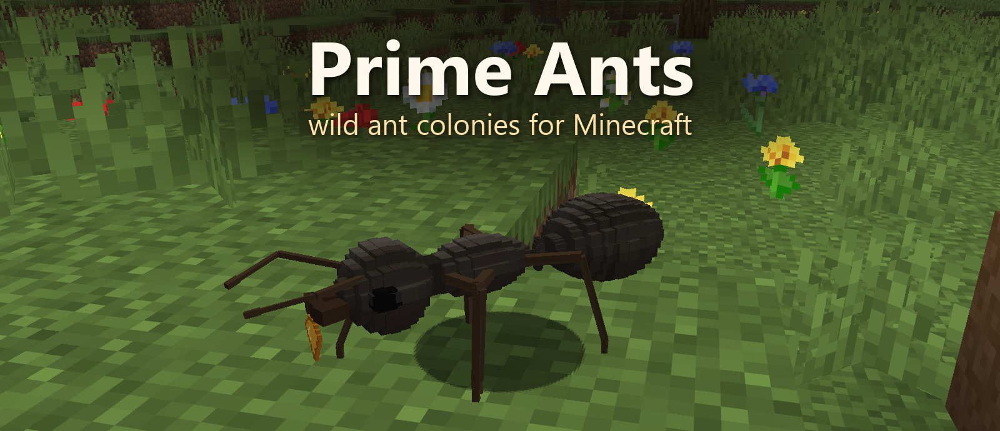
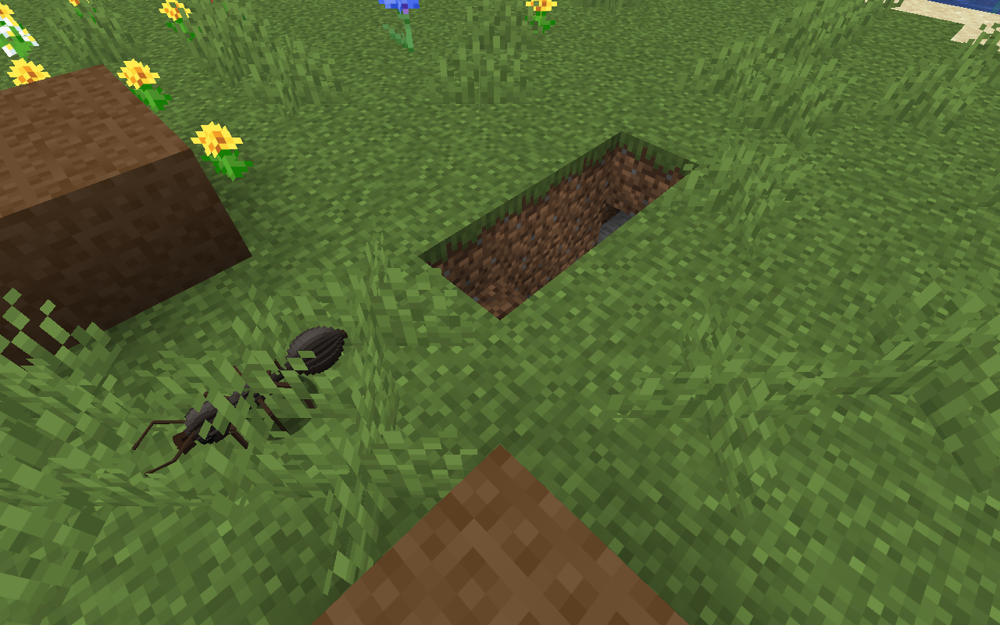
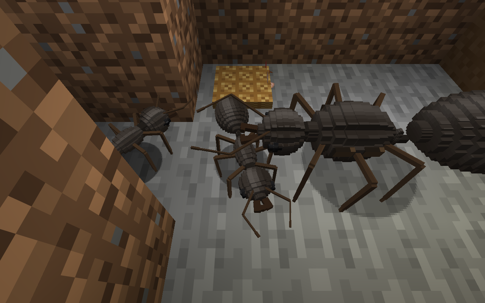

<p align="center">
  
</p>

<h3 align="center">Дикие колонии муравьёв для Minecraft — каждый муравей здесь настоящее существо.</h3>

<p align="center">
  🇬🇧 <a href="README.md">Read in English</a>
</p>

<p align="center">
  
  
  
  
  <br>
  <a href="https://github.com/SupremeSoviet/prime-ants/releases/latest"></a>
  
  
  <a href="LICENSE"></a>
</p>

<p align="center">
  <a href="https://github.com/SupremeSoviet/prime-ants/releases/latest"><b>⬇️ Скачать</b></a> ·
  <a href="#-как-начать">Как начать</a> ·
  <a href="#%EF%B8%8F-галерея">Галерея</a> ·
  <a href="#%EF%B8%8F-планы">Планы</a>
</p>

---

> **[Выпуск 0.2.0](https://github.com/SupremeSoviet/prime-ants/releases/tag/v0.2.0):** принятая complete6 T21, свежая fast-проверка T23 и существующий native-клиент/четыре PNG.
> 2026-10-18 в 08:33:25 UTC владелец принял исключение записи клиента: chunk `(10,9)`, cell `(2,2)`, 0–2 351 суммарный загруженный такт поиска/ожидания при лимите 1 200. Соблюдение не доказано; принятие выпуска не доказывает соблюдения предела.
> [Текущая приёмка](docs/release-0.2.0-acceptance.md) · [EN/RU заметки](docs/release-0.2.0.md) · [Известные timeout](docs/known-flaky-timeouts.md).

## 🐜 Что это?

Prime Ants заселяет ваш мир дикими колониями чёрного садового муравья, *Lasius niger*.

Молодая матка выбирает уголок луга, выкапывает маленькую камеру и сама выращивает первых рабочих. Дальше за дело
берётся колония: рабочие открывают вход, выносят землю в курган, приносят домой нектар и добычу и кормят выводок изо
рта в рот.

Никаких скрытых счётчиков. **Колония — это ровно те муравьи, которых вы видите.** Если муравей погиб, его больше нет, и
колонии придётся вырастить замену.

## ✨ Что умеют муравьи

| | |
|---|---|
| 👑 **Матки сами основывают колонии** | на равнинах, лугах и в цветочных лесах, прямо в естественном рельефе |
| 🥚 **Настоящий цикл развития** | яйцо → личинка → кокон → светлый молодой муравей → взрослый |
| ⛏️ **Гнёзда в земле** | ступеньки и камеры высотой в два блока, а вынутая земля уходит в курган |
| 🌼 **Настоящая еда, которую несут домой** | нектар с цветов, мелкая добыча в траве и вкусное, что бросили вы |
| 🤝 **Делятся едой** | няньки кормят матку и личинок, рабочие передают друг другу сахар изо рта в рот |
| 📈 **Растут по средствам** | колония растёт ровно настолько, насколько хватает еды; муравьи стареют, голодают и умирают |
| 🛡️ **Защищают дом** | ударите муравья или сломаете гнездо — рабочие рядом начнут кусаться |
| 🔦 **К ним можно зайти в гости** | спуститься по ступенькам, осветить камеру факелом и посмотреть на ясли |
| 🏰 **Готовые гнёзда** | молодые и зрелые колонии могут появляться в новом подходящем рельефе |
| 🧱 **Развитие колонии** | четыре функции камер, физические улучшения до третьего уровня и великие укрепления |
| 💾 **Продолжение после загрузки** | ограниченное автоматическое догоняющее моделирование; точная область проверки сохранений описана в заметках |

> 🕰️ Один игровой день — это примерно месяц жизни колонии.

## 🖼️ Галерея

Четыре отдельно просмотренных native F2 PNG принятого runtime 0.2.0 из существующего свежего Survival-мира T21. Владелец принял раскрытое исключение записи; новой клиентской кампании или съёмки не было.

| | |
|:---:|:---:|
| <br><sub>Внешний вид сгенерированного Young-гнезда у деревни; трава сохранена.</sub> | <br><sub>Настоящий рабочий у существующего входа до освещения игроком.</sub> |
| <br><sub>Живые матка, рабочие и пищевой cache в существующей камере.</sub> | <br><sub>Камера, рабочие и физический cache с противоположного угла.</sub> |

<sub>Сгенерированное начальное состояние, обычная скорость, доступ камеры и один штатный факел. Непрерывная работа после освещения не заявлена. [Происхождение](docs/release-0.2.0-acceptance.md). Баннер показывает прежнюю модель.</sub>

## 🚀 Как начать

**Понадобятся:** Minecraft Java Edition 26.3 · Java 25 · Fabric Loader 0.19.5 · Fabric API 0.161.0+26.3

1. Установите профиль [Fabric](https://fabricmc.net/use/installer/) для Minecraft 26.3.
2. Положите [`prime_ants-0.2.0.jar`](https://github.com/SupremeSoviet/prime-ants/releases/download/v0.2.0/prime_ants-0.2.0.jar) и подходящий
   [Fabric API](https://modrinth.com/mod/fabric-api) в папку `mods`.
3. Создайте **новый мир** и отправляйтесь искать муравьёв. 🔍

## 🔎 Как найти колонию и что с ней делать

- **Где искать.** На равнинах, лугах и в цветочных лесах. Ищите небольшой курган земли рядом с входом-лесенкой или
  матку, которая копает.
- **Терпение.** Каждая стадия выводка длится около 10 минут, а первые рабочие появляются примерно через полчаса после
  первых яиц. Колонии живут, только пока их чанки загружены, так что держитесь неподалёку.
- **Подкормка.** Бросьте рядом с тропой яблоки или сладкие ягоды (сахар) и сырую курицу или гнилую плоть (белок), а
  потом отойдите хотя бы на четыре блока. Фуражиры подберут еду и унесут домой.
- **В гостях.** Когда рабочие откроют вход, спускайтесь по ступенькам высотой в два блока. Поставьте факел на стену,
  чтобы было видно, и не трогайте стены, ясли и кладовую.
- **Этикет.** Смотреть и кормить можно сколько угодно. Если бить муравьёв или ломать гнездо, рабочие начнут кусаться
  (полсердца за укус).

## ⚠️ Стоит знать

**Выпуск 0.2.0 сохраняет раскрытое принятое владельцем исключение записи и ограничения ниже.**

- Один вид, *Lasius niger*. Готовые молодые и зрелые колонии в новом рельефе и автоматическое
  догоняющее моделирование реализованы; брачных лётов и активного сбора плодов пока нет.
- Укрепления великой колонии и физические улучшения третьего уровня приняты в контролируемых тестах.
  Это не полная игровая кампания роста без вмешательства.
- Два открытия конечного молодого/зрелого мира в новых процессах подтвердили точное сохранение и обычную
  работу после загрузки. Это не устойчивость к авариям и не широкая проверка сборок модов.
- Сложный рельеф, недостаток еды и теснота могут остановить колонию. Длительные сеансы и мультиплеер
  проверены ограниченно; делайте резервные копии миров.

Несколько одновременно загруженных великих колоний могут вызывать существенные лаги.
T16: одна колония со **120 взрослыми — около 19 TPS, среднее 52 мс, p95 примерно 66 мс**;
три колонии с **360 взрослыми — около 6,7 TPS, среднее 149 мс, p95 примерно 216 мс**.
Контролируемый сервер разработки: Ryzen 7 7700 (8 ядер/16 потоков), Windows 11 Pro build 26200,
около 95,1 ГиБ ОЗУ, Temurin 25.0.3+9/G1, куча 3 ГиБ; Minecraft 26.3, Loader 0.19.5,
Fabric API 0.161.0+26.3 и Loom 1.18.2. На сцену 600 прогревочных и 2 400 измеренных тактов,
работа/выводок 1/1, обычный запрос 20 TPS; нагрузка общей машины и инструменты тестирования включены.
Это такты сервера, не FPS клиента и не гарантия для любого оборудования. Бюджеты среднего 40 мс / p95 50 мс
не выполнены. Производительность остаётся ограничением вне допуска 0.2.0; новых замеров нет.
См. [условия T16](docs/t16-cap-performance.md), [финальные EN/RU заметки](docs/release-0.2.0.md),
[точные известные тайм-ауты](docs/known-flaky-timeouts.md) и [текущую приёмку](docs/release-0.2.0-acceptance.md).

## 🗺️ Планы

- 🪽 брачные лёты, после которых молодые матки основывают колонии по соседству
- 🏰 готовые молодые/зрелые гнёзда при генерации мира — выпущены в 0.2.0
- 🌿 тли и падь
- ⚔️ пограничные стычки и войны между колониями
- 📓 полевой дневник для ваших наблюдений
- 🐜 новые виды: рыжий лесной муравей, муравей-жнец и муравей-листорез

## 🛠️ Сборка из исходников

```bash
./gradlew build
```

Нужен JDK 25. Готовый jar появится в `build/libs/`, а заодно прогонятся модульные, модельные и внутриигровые серверные
тесты.

Исторический тайм-аут великой колонии сохранён в историческом отчёте; позднее её контролируемая проверка прошла.
Текущая проверка корректности описана в [отчёте этапа 1](docs/stage-1-report.md).
Отдельный быстрый набор каждого хода и упаковку можно запустить так:

```bash
./gradlew checkFast assemble --console=plain --rerun-tasks
```

Это проверка быстрого набора, а не полного этапа 1 или выпуска. Локальные сборки имеют версию **0.2.0**; точные проверенные байты выпуска определяются опубликованным файлом и SHA256SUMS по ссылке выше.

## 📚 Ещё

- [Руководство игрока](docs/player-guide.md)
- [Технический отчёт к 0.1.0](docs/slice-1-report.md) (на английском)
- [Частичный отчёт этапа 1](docs/stage-1-report.md) (на английском)
- [Дизайн-решения](docs/00-decisions.md)

## 📄 Лицензия

[MIT](LICENSE)
